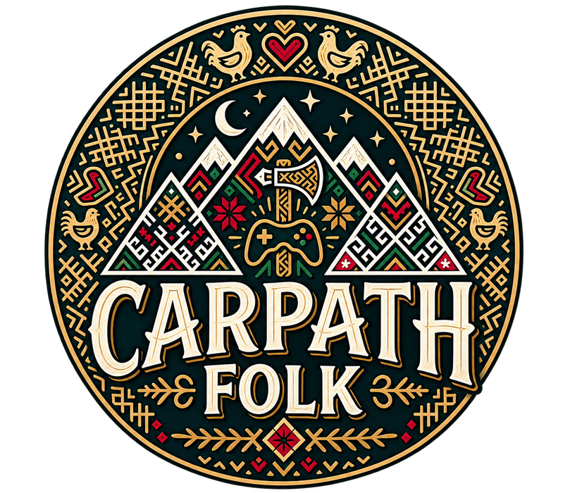

# CARPATH FOLK

**Independent Game Studio & Publisher**

*We create worlds shaped by meaningful decisions.*

Carpath Folk is an independent game studio and publisher crafting games built on deep systems and meaningful choices — from strategic management simulations to story-driven adventures in worlds worth exploring.

## Games

### Rink Boss — *In Development*
*Hockey Management Simulation*

A deep hockey management sim — build your club through scouting, contracts, and salary-cap strategy, develop talent through your junior team, and shape every game through lines, tactics, and in-game adjustments while watching it unfold in a simplified 3D match viewer.

### New Beginning — *Future Concept*
*Historical Action RPG*

A planned collection of five independent historical campaigns, each playable in any order. Completing all five unlocks a unified ending. Early-stage concept, not yet in active development.

### Hamlet Founders: From Scratch — *Future Concept*
*Settlement-Building Simulation*

A peaceful settlement-building and economic simulation where players grow a small hamlet into a thriving civilization through resource chains, population growth, and evolving technology. Its defining idea is a living society of individuals — families, aging generations, and settlements that keep evolving with or without the player's direct hand. Early-stage concept, not yet in active development.

<em>Our games are built around meaningful choices, interconnected systems, and lasting player experiences.</em>

---

© Carpath Folk. All rights reserved.

  

